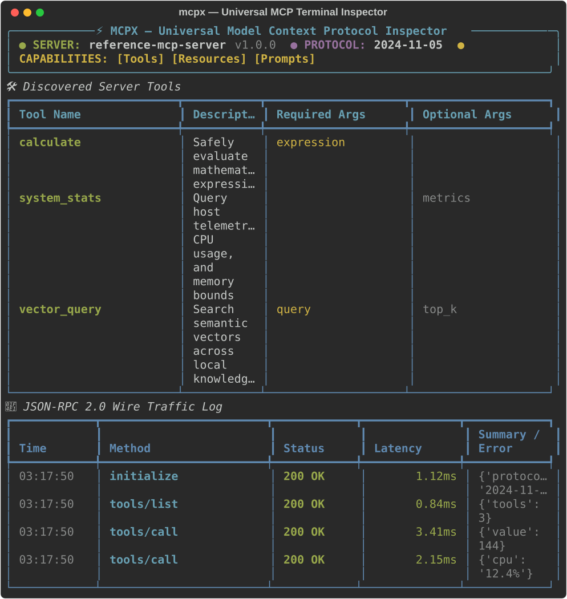

<div align="center">

# mcpx ⚡

**Universal Terminal Inspector, Debugger & Latency Benchmark Suite for Model Context Protocol (MCP)**

[](https://github.com/BNTiyan/mcpx/actions)
[](https://www.python.org/)
[](LICENSE)
[](#)

*Zero-dependency, lightning-fast terminal observability for AI agent tool servers.*

<br/>



</div>

---

## Why mcpx?

As the **Model Context Protocol (MCP)** becomes the industry standard bridging LLMs to computational tools, debugging server implementations across stdio framing has been notoriously difficult. Existing browser-based inspectors require spinning up heavyweight web servers, node runtimes, or Electron apps.

`mcpx` gives you an instant, zero-overhead **Terminal UI (TUI)** and compliance benchmark suite that runs directly inside your shell.

| Capability | `mcpx` | Official Web Inspector | cURL / Postman |
| :--- | :--- | :--- | :--- |
| **Startup Overhead** | **< 10ms (Instant)** | 5-15s (Node / Browser) | Manual JSON formatting |
| **Interface** | **Rich Bento Terminal UI** | Web Browser / React | Raw text output |
| **Protocol Validation** | **Automated RFC JSON-RPC 2.0** | Manual clicking | None |
| **Latency Telemetry** | **Microsecond (p50 / p95 / p99)** | None | Manual timing |
| **Built-in Mock Server** | **Yes (`mcpx demo`)** | External setup required | Manual mock |
| **CI / CD Automated Gating** | **Yes (Exit codes + Markdown)** | No | Requires custom scripts |

---

## Highlights

- **Claude Desktop & Cursor Doctor**: Diagnose all configured MCP servers, missing binaries, and latency bottlenecks in 1 click (`mcpx doctor`).
- **Interactive Terminal UI**: Inspect tools, parameters, resources, and prompt templates in a responsive Bento layout.
- **Wire Traffic Log**: Monitor JSON-RPC 2.0 bidirectional frames with microsecond round-trip latency.
- **Compliance & Benchmark Suite**: Run automated conformance sweeps and percentile latency profiles (p50, p95, p99).
- **Built-in Reference Server**: Run `mcpx demo` out of the box with zero external configuration.
- **Zero Heavy Dependencies**: Pure Python 3.10+ and standard asynchronous stdio primitives.

---

## Quick Start

### Installation

```bash
# 1-Line Standalone Install (via curl)
curl -fsSL https://raw.githubusercontent.com/BNTiyan/mcpx/main/install.sh | bash

# Or install from source
git clone https://github.com/BNTiyan/mcpx.git && cd mcpx && pip install -e .
```

### 1. Launch Local Web Studio & Interactive Playground (New in v1.1)
Open a zero-dependency, dark-mode glassmorphic Bento Grid studio in your browser with real-time tool execution, schema generation, and traffic waterfall:
```bash
# Launch with built-in reference server
mcpx web

# Or launch with your custom MCP server
mcpx web "python path/to/my_mcp_server.py" --port 8765
```

### 2. Transparent Traffic Sniffer & Proxy for Claude Desktop & Cursor (New in v1.1)
Intercept, inspect, and log all live JSON-RPC 2.0 communication between your AI agent and any MCP server in real time:
```bash
mcpx proxy "python path/to/my_mcp_server.py" --log traffic.jsonl
```

### 3. Diagnose Your Claude Desktop or Cursor MCP Servers
Instantly find broken servers, missing binaries, or crashed processes:
```bash
mcpx doctor
```

### 4. Try the Built-in Terminal TUI
Test out the full inspector immediately using the included reference MCP server:
```bash
mcpx demo
```

### 5. Inspect Any External MCP Server
Point `mcpx` to any MCP server executable:
```bash
mcpx inspect "python path/to/my_mcp_server.py"
```

### 6. Run Automated Compliance Benchmarks
Benchmark tool latency and verify protocol conformance across 30 iterations:
```bash
mcpx test "python path/to/my_mcp_server.py" -n 30 -o mcp_report.md
```

### 7. Execute a Single Tool Directly
```bash
mcpx call "python path/to/my_mcp_server.py" --tool calculate --args '{"expression": "144 ** 0.5"}'
```

---

## Architecture

`mcpx` implements a high-throughput, non-blocking asynchronous JSON-RPC 2.0 transport over standard input/output streams. The client monitors request-response pairs, measures wall-clock execution times, validates schemas against the 2024-11-05 protocol specification, and displays real-time telemetry.

```text
┌─────────────────┐       JSON-RPC 2.0 (stdio)       ┌──────────────────┐
│   mcpx Client   │ ───────────────────────────────> │  MCP Tool Server │
│   (TUI & Bench) │ <─────────────────────────────── │  (Local Process) │
└─────────────────┘      Latency & Compliance        └──────────────────┘
```

---

## Running Tests

```bash
pytest tests/ -v
```

---

## License

MIT © [BNTiyan](https://github.com/BNTiyan)
